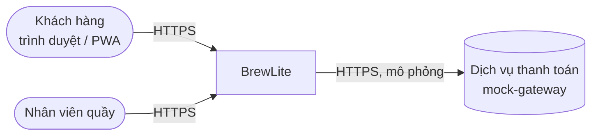
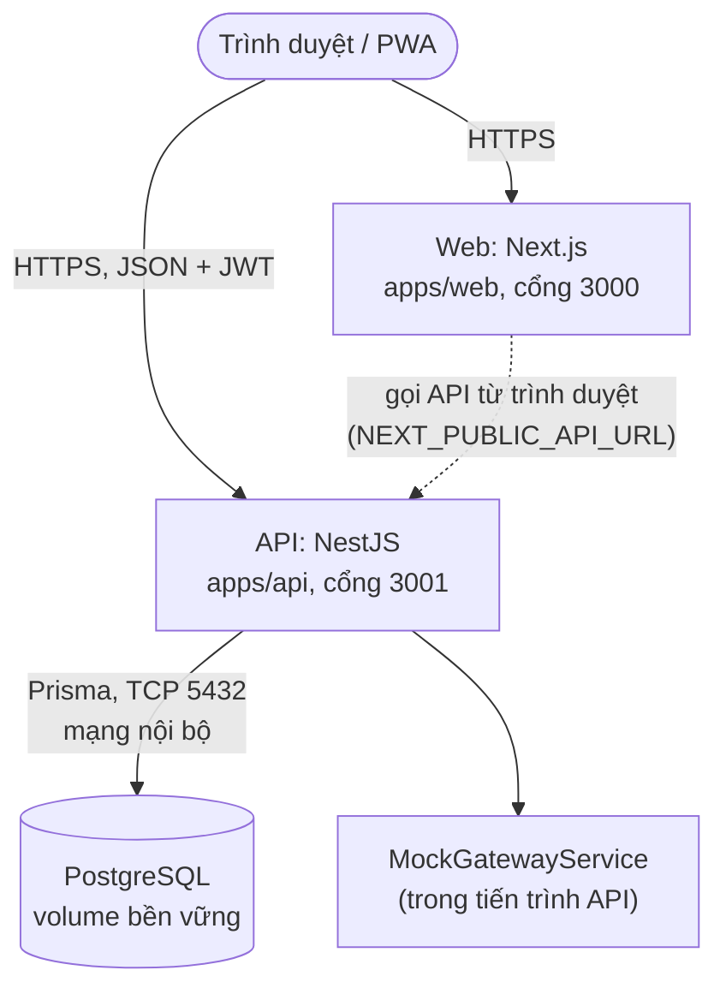

# Kiến trúc hệ thống BrewLite (Task 3.1)

Phiên bản 1.0. Tài liệu mô tả kiến trúc **đích** của bản giao nộp. Những điểm chưa có trong code hiện tại được đánh dấu **[Sprint 2]**. Các quyết định quan trọng được ghi thành ADR trong `docs/architecture/adr/`.

## 1. Phương pháp trình bày

Dùng mô hình **C4** (mức Context và Container) kết hợp **kiến trúc phân lớp** ở bên trong backend. Mức Component chỉ trình bày cho NestJS API vì đây là nơi chứa nghiệp vụ.

## 2. C4 mức 1 – System Context

- Khách hàng: xem menu, đặt đơn, thanh toán, theo dõi đơn (UC-01 đến UC-05).
- Nhân viên quầy: cập nhật trạng thái đơn (UC-06, FR-13, mức Should).
- Dịch vụ thanh toán: **mô phỏng**, nằm trong mã nguồn API (FR-16 là Won't, không tích hợp cổng thật).

## 3. C4 mức 2 – Container

| Container | Công nghệ | Trách nhiệm | Mã nguồn |
|---|---|---|---|
| Web | Next.js 16, React 19, TanStack Query, Zustand, Tailwind | Giao diện mobile-first, giỏ hàng phía client, gọi API | `apps/web` |
| API | NestJS, class-validator, JWT, bcryptjs | Nghiệp vụ, xác thực, validate, tính giá phía server | `apps/api` |
| Database | PostgreSQL 16 | Lưu product, user, order, payment | `apps/api/prisma` |
| Payment (mô phỏng) | Class `MockGatewayService` | Trả thành công/thất bại sau độ trễ giả lập | `apps/api/src/payments` |

## 4. Component trong NestJS API (kiến trúc phân lớp)

Mỗi domain là một module NestJS, tách ba lớp: **Controller** (HTTP, DTO, guard) → **Service** (nghiệp vụ) → **Prisma** (truy cập dữ liệu).

| Module | Endpoint | Ghi chú |
|---|---|---|
| `ProductsModule` | `GET /products`, `GET /products/:id` | Dữ liệu từ seed |
| `AuthModule` | `POST /auth/register`, `POST /auth/login` | bcrypt băm mật khẩu, ký JWT |
| `OrdersModule` | `POST /orders`, `GET /orders/:id` | Giá tính lại ở server (`pricing.ts`), `AuthGuard` bảo vệ |
| `PaymentsModule` | `POST /payments` | Gọi `MockGatewayService`, cập nhật Payment và Order trong một transaction |
| `PrismaModule` | – | Cung cấp `PrismaService` dùng chung |
| `HealthModule` **[Sprint 2]** | `GET /health` | Kiểm tra API và kết nối DB (NFR-08) |
| Bổ sung **[Sprint 2]** | `GET /orders`, cập nhật trạng thái đơn, idempotency, trừ tồn kho trong transaction | FR-10, FR-12, FR-13, NFR-06 |

Quy tắc phụ thuộc: Controller chỉ gọi Service; Service chỉ gọi `PrismaService` và các service cùng tầng; frontend không truy cập database trực tiếp.

## 5. Dữ liệu và migration

- PostgreSQL, truy cập bằng Prisma (ADR-003). Lược đồ ở `apps/api/prisma/schema.prisma`.
- Migration nằm ở `apps/api/prisma/migrations/` (hiện có 4 bản: init, add_orders, add_users, add_payments).
- Seed bằng `prisma/seed.js` cho dữ liệu menu mẫu.
- Local: `prisma migrate dev`. Production: `prisma migrate deploy`, chạy **trước** khi bản mới nhận traffic (xem ADR-006).

## 6. Dịch vụ thanh toán mô phỏng

`MockGatewayService.charge()` chờ khoảng 300 ms rồi trả thành công, hoặc thất bại khi request có `simulateFailure`. Không có khóa hay cấu hình cổng thật trong repo (FR-16, NFR-04). Idempotency dựa trên cột `Payment.idempotencyKey` (unique) **[Sprint 2]**, xem ADR-005.

## 7. Logging, health check, cấu hình

| Chủ đề | Thiết kế | Trạng thái |
|---|---|---|
| Cấu hình | `@nestjs/config`, mọi giá trị đọc từ biến môi trường; repo chỉ có `.env.example` | Có |
| Secret | `JWT_SECRET`, `DATABASE_URL` đặt trong secret của CI và nền tảng deploy, không commit | Quy ước |
| Logging | Logger của NestJS ghi ra stdout; nền tảng deploy thu log. Không log mật khẩu, token hay `DATABASE_URL` | Mặc định; cần rà soát **[Sprint 2]** |
| Health check | `GET /health` trả 200 khi API chạy và truy vấn DB thành công; dùng cho nền tảng deploy và smoke test | **[Sprint 2]** |
| CORS | Chỉ cho phép origin của web (đọc từ biến môi trường, hiện đang cố định `localhost:3000`) | Cần sửa **[Sprint 2]** |
| Validation | `ValidationPipe` với `whitelist` và `forbidNonWhitelisted` ở backend; kiểm tra thêm ở frontend | Có |

## 8. Lý do chọn kiến trúc, ưu điểm, hạn chế, trade-off

**Lý do.** Ba thành phần Next.js, NestJS, PostgreSQL là bắt buộc. Phạm vi là một ứng dụng đặt đồ uống, một nhóm nhỏ, hai Sprint, nên cần kiến trúc đơn giản, dễ kiểm thử và dễ triển khai.

| Quyết định | Ưu điểm | Hạn chế / trade-off |
|---|---|---|
| Monolith module hóa (NestJS) thay cho microservices | Một đơn vị deploy, transaction đơn giản giữa Order, Payment và tồn kho, ít chi phí vận hành | Khó scale từng module riêng; chấp nhận được với quy mô MVP |
| Monorepo `apps/web` + `apps/api` + `docs` | Một PR chứa cả code, test và tài liệu; truy vết dễ | CI phải biết chỉ build phần bị đổi để khỏi chậm |
| Tính giá và tồn kho ở server | Không tin dữ liệu client, tránh bán sai giá | Giá được tính hai lần (client để hiển thị, server để chốt) nên phải giữ hai bản `pricing` đồng bộ |
| Thanh toán mô phỏng trong tiến trình API | Không phụ thuộc bên ngoài, test được cả nhánh thất bại | Không chứng minh được tích hợp cổng thật; ranh giới `MockGatewayService` giúp thay sau này |
| Triển khai bằng Docker trên Render | Cùng image chạy local và production; có health check, private network, deploy hook | Phụ thuộc nền tảng; gói miễn phí có thể ngủ khi không có traffic (xem ADR-006) |

## 9. Danh sách ADR

| ADR | Quyết định |
|---|---|
| [001](adr/001-monorepo.md) | Monorepo |
| [002](adr/002-modular-monolith-nestjs.md) | Modular monolith với NestJS phân lớp |
| [003](adr/003-postgresql-prisma.md) | PostgreSQL + Prisma migration |
| [004](adr/004-jwt-authentication.md) | JWT + bcrypt |
| [005](adr/005-mock-payment-idempotency.md) | Thanh toán mô phỏng + idempotency key |
| [006](adr/006-render-docker-deployment.md) | Deploy bằng Docker lên Render, CI/CD bằng GitHub Actions |

## 10. Truy vết

| Thành phần kiến trúc | Yêu cầu | Mã nguồn |
|---|---|---|
| Web (Next.js) | FR-01 đến FR-04, NFR-05 | `apps/web` |
| ProductsModule | FR-01, FR-02 | `apps/api/src/products` |
| AuthModule | FR-05, FR-06, NFR-02, NFR-03 | `apps/api/src/auth` |
| OrdersModule | FR-07, FR-11, FR-12, NFR-06 | `apps/api/src/orders` |
| PaymentsModule + mock gateway | FR-09, FR-10, FR-16 | `apps/api/src/payments` |
| PostgreSQL + migration | NFR-09 | `apps/api/prisma` |
| HealthModule, Docker, CI/CD | NFR-07, NFR-08, NFR-10, NFR-11 | **[Sprint 2]** |
